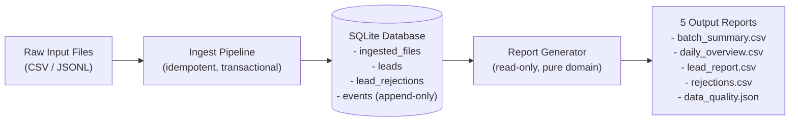
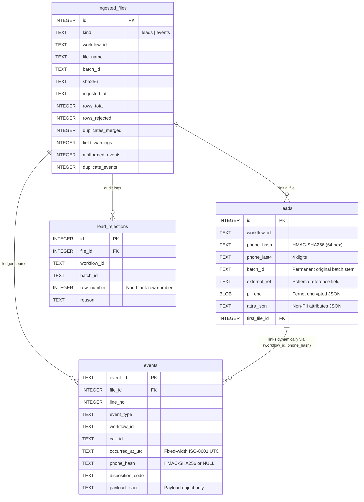

# Submission

## Candidate
- **Name:** chinmaye hg
- **Assignment chosen:** A (Data)
- **Time spent (honest estimate):** ~5 hours (1 hr planning & architecture, 4 hrs AI-assisted development & verification)

## How to run
```bash
# Setup virtual environment and dependencies
python -m venv .venv && source .venv/bin/activate
pip install -r requirements.txt

# Generate synthetic dataset
python assignment-a-data/tools/generate_data.py --seed 42 --scale small --out data

# Ingest drops incrementally
python -m solution ingest data/drop_1
python -m solution ingest data/drop_2

# Produce reports
python -m solution report --out reports/

# Self-check invariants
python -m solution verify

# Run test suite
pytest
```

## Design

### Architecture Overview
The pipeline adheres strictly to the core principle: **store facts at ingest time, derive meaning at report time**.



1. **Ingest Phase**: Lead CSVs are mapped dynamically against JSON workflow schemas (normalizing Indian mobile phone numbers, multi-format dates, currency strings, and enums). Leads are identified by `(workflow_id, canonical_phone)`; first-seen leads retain their permanent `batch_id`, while subsequent duplicate rows merge non-null attributes using last-write-wins rules. Call events from JSONL files are deduplicated and inserted into an append-only ledger (`events`) protected against modifications or deletions by SQLite triggers.
2. **Report Phase**: Rather than mutating events during ingestion, linking between events and leads, supervisor override resolution, and call outcome aggregation are evaluated dynamically from stored history. This guarantees that events delivered before their corresponding leads (e.g. drop 1 call events for drop 2 lead uploads) resolve automatically and deterministically.
3. **PII Protection**: Personally Identifiable Information is never stored in plaintext. Customer phone numbers are transformed into 64-character keyed HMAC-SHA256 digests (`phone_hash`) incorporating the `workflow_id` to prevent rainbow-table reverse lookups across Indian mobile numbering space. Customer names and other PII fields are encrypted at rest using AES-128-CBC + HMAC-SHA256 authenticated symmetric encryption via Fernet (`cryptography.fernet`). Masked phone numbers (`+91******1234`) are rendered at report time via an unencrypted `phone_last4` column without requiring full ciphertext decryption.

### Database Schema



## Decisions & assumptions

| # | Decision | Why | Alternative considered |
|---|---|---|---|
| 1 | HMAC-SHA256 with a secret key (`f"{workflow_id}\|{canonical_phone}"`) instead of a plain hash. | Plain SHA-256 on 10-digit Indian mobile numbers (~4 billion combinations) is trivially rainbow-table reversible; keyed HMAC prevents enumeration. | Plain SHA-256 without salt/key. |
| 2 | Store `phone_last4` separately in `leads`. | Allows fast, decryption-free rendering of masked phones (`+91******1234`) in `lead_report.csv`. | Decrypting the full phone or reconstructing from raw PII at report generation time. |
| 3 | Derive linking, orphans, and unknown dispositions at report time instead of ingest time. | Guarantees idempotency and drop-order equivalence: events arriving before their leads (drop 1 vs drop 2) link automatically without re-ingesting events. | Linking at ingest time and attempting backfill mutations on previously ingested events. |
| 4 | Malformed events = invalid JSON, JSON non-object, or empty/missing `event_id`. | Strictly preserves the append-only ledger for all parseable event structures. Events with unparseable timestamps or missing schemas stay in ledger and count as orphans at report time. | Silently dropping lines with unparseable timestamps or failing the ingest transaction. |
| 5 | Required non-phone field present but invalid rejected as `invalid_<field_name>`. | Provides deterministic, descriptive rejection feedback consistent with schema validation rules. | Generic `invalid_field` or ignoring validation on non-phone fields. |
| 6 | Two columns mapping to the same field: first column wins. | Ensures deterministic header resolution in case CSVs provide redundant or duplicate alias headers. | Last column wins or throwing an error. |
| 7 | Unknown disposition matching is case-sensitive and exact. | Prevents silent corruption from typos or unlisted statuses (e.g. `RENEWD` vs `renewed`). | Case-insensitive matching or mapping to fallback. |
| 8 | Calls without a linked `call.initiated` are not counted. | The spec defines a call as a `(workflow_id, call_id)` having a linked `call.initiated` event. | Counting orphan call fragments or connected events without initiation. |
| 9 | Multiple `call.initiated` for one call: earliest by `(occurred_at, event_id)` wins. | Provides deterministic call start timestamp even if network retries duplicated initiation events with slight delays. | Latest initiation or arbitrary first-seen order. |
| 10 | Ties between equal timestamps: larger `event_id` wins ("latest"). | Ensures total ordering and determinism when events occur within the same sub-second window. | Arbitrary database rowid order. |
| 11 | Event types outside the six known types are stored and ignored. | Maintains append-only audit ledger without crashing on upstream feature additions. | Rejecting unknown event types as malformed. |
| 12 | Batches with zero valid leads do not appear in `batch_summary.csv`. | Batch summary reflects lead cohorts; batches that produced only rejections contain no leads to summarize. | Listing batch with zeros for all lead metrics. |
| 13 | `rejections_by_reason` in `data_quality.json` lists only reasons that actually occurred, keys sorted. | Avoids cluttering summary with dozens of unused schema-specific rejection keys. | Pre-populating all hypothetical schema error keys with 0. |
| 14 | Files in the same directory are processed in plain `sorted()` filename order. | Ensures deterministic, repeatable file ingestion order across all operating systems. | Filesystem directory iterator order (`os.listdir`). |
| 15 | File skip key is `(kind, workflow_id, file_name, sha256)`. | If a file changes content, its new SHA-256 causes re-processing; identical re-runs are cleanly skipped. | Name-only check or always overwriting. |
| 16 | Dates require zero-padded day/month and a 4-digit year. | Adheres strictly to ISO and day-first standards (`YYYY-MM-DD`, `DD/MM/YYYY`, `DD-MM-YYYY`, `DD-Mon-YYYY`) and prevents ambiguous year representations. | Permissive dateutil parsing. |

## Failure modes considered

- **Re-runs & Duplicate Delivery**: Ingesting an already processed file calculates its SHA-256 digest and matches against `ingested_files`. Re-running does zero database writes and leaves table counts, counters, and reports identical.
- **Mid-file Process Crashes**: Each file is processed in an explicit atomic database transaction (`with transaction(conn):`). If a crash, out-of-memory, or power failure occurs mid-file, uncommitted writes roll back entirely, preventing corrupt half-ingested states. Re-running the command resumes at the uncommitted file.
- **Malformed Event Lines**: Handled per-line without aborting valid sibling events. Corrupted JSON lines, JSON arrays, and missing/empty `event_id` records increment `malformed_events` and are skipped.
- **Out-of-Order Delivery & Events Before Leads**: Call events arriving in drop 1 for leads uploaded in drop 2 are stored safely in the append-only ledger. When reports run after drop 2, the dynamic linking step links them to their newly arrived leads, automatically decrementing orphan counts in final reporting.
- **Supervisor Overrides on Calls with No Prior Phone**: Overrides carry no phone number. They link through `(workflow_id, call_id)` to the lead identified by that call's other linked events. If no prior event for that call exists in the ledger, the override is safely classified as an orphan.
- **Key Changes Between Runs**: Changing HMAC or Fernet keys between runs invalidates existing hashes and tokens. The system warns if default keys are used, and production deployments would load static keys from a central secrets manager (e.g. AWS Secrets Manager or HashiCorp Vault).
- **What is NOT handled**:
  - Unstructured free-text notes containing customer PII in unmapped columns (unmapped columns are ignored and discarded).
  - Merging leads across different workflows (workflows remain strictly isolated by design).
  - SQLite concurrent multi-process writer contention (SQLite handles concurrency via WAL mode with single-writer serialization).

## Testing

- **Pure Unit Testing (`test_parsing.py`, `test_pii.py`, `test_schema.py`)**:
  - Tested 8 valid phone format variations, 10 invalid variations, boundary edge cases (`9198765432`), leap years, currency prefixes, half-up rounding, and IST midnight rollover.
- **Domain Logic Testing (`test_domain.py`)**:
  - Hand-derived test cases verifying override precedence over sets, later overrides beating earlier overrides, fallback on unknown override codes, and bucket priority ordering.
- **Idempotency & Drop Order Invariance (`test_idempotency.py`)**:
  - Verified:
    1. Re-ingesting drops leaves table counts and report files identical.
    2. Ingesting `drop_1` then `drop_2` equals ingesting `data/` all at once.
    3. Ingesting **events before leads** produces byte-identical report files.
- **Independent Oracle Implementation (`tests/oracle.py` & `tests/test_oracle.py`)**:
  - Implemented an independent, slow reference pipeline that processes raw files in-memory without SQL or imports from `solution/`.
  - Tested against seeds **1, 2, 3, 7, and 42**: verified 100% byte-for-byte identical output files across all seeds.
- **Invariant Self-Check (`test_end_to_end.py` & `verify.py`)**:
  - Validated ledger append-only triggers, lead count conservation, event count conservation, and batch summary bucket totals.

## Results
- **Time spent**: ~5 hours (1 hr planning & architecture, 4 hrs AI-assisted development & verification)
- **Surprising data discoveries**:
  - Overrides arrive hours or days after call completion and never carry phone numbers; linking via `(workflow_id, call_id)` to the call's original events is essential.
  - Events frequently arrive before leads across daily drops, confirming that static linking at ingest time would be brittle compared to dynamic report-time linking.
- **Large Dataset Benchmark (`--scale large`)**:
  - Dataset: 140,000 leads and 632,602 call events across 2 drops.
  - Drop 1 Ingest: **92.20s**
  - Drop 2 Ingest: **139.24s**
  - Report Generation (all 5 files): **24.92s**
  - Verification Suite: **17.45s**
  - Total Pipeline Time: **256.35s** (~4.2 minutes)

## If I had another day

1. **Partitioned Ledger Archival**: Partition ledger storage by month/quarter into read-only SQLite archive databases or Parquet lakehouse tables to keep active working set memory minimal.
2. **Streaming Event Ingestion & Windowing**: Stream events directly into a distributed append-only log (e.g. Apache Kafka or Redpanda) and materialize hourly call aggregates using incremental state stores (e.g. DuckDB or SQLite materialized views).
3. **Columnar Export Formats**: In addition to standard CSVs, emit Snappy-compressed Parquet files for client analytical dashboards.

## Running for 100k leads/day in Production

- **Scheduling & Orchestration**: Orchestrate daily ingest and reporting runs using a durable workflow engine (such as Temporal, Dagster, or Airflow). Pipeline drops are triggered upon arrival of upstream S3/GCS object delivery notifications.
- **Retries & Idempotency**: Each file upload task uses deterministic idempotency keys (`(tenant_id, workflow_id, file_name, sha256)`). Retries of failed tasks are inherently idempotent and safe to resume without human intervention.
- **Backfills & Late Arrivals**: Because linking and metrics derivation happen at report time, backfilling missed lead batches or delayed telephony event dumps requires only ingesting the missing files and re-triggering the reporting job.
- **Secrets Management**: Load `AU_HMAC_KEY` and `AU_FERNET_KEY` dynamically at boot from AWS Secrets Manager or HashiCorp Vault with strict IAM role access and automated rotation policies.
- **Monitoring & Alerting**: Emit OpenTelemetry metrics for rows processed per second, rejection rates by reason, orphan event percentage, and database write latency. Trigger PagerDuty alerts if orphan rates spike above 2% or if schema rejection rates exceed historical campaign baselines.
