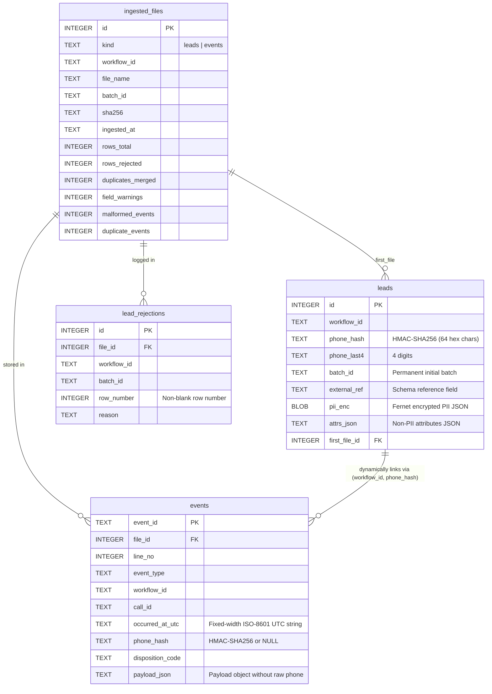

# Interaction Ledger & Reporting Pipeline (Assignment A)

A high-performance, robust, and idempotent data pipeline built with Python 3.11+ standard library, SQLite, and `cryptography` (Fernet + HMAC-SHA256).

---

## 1. Quick Start

Run from repository root:

```bash
# 1. Virtual environment & dependencies
python -m venv .venv
source .venv/bin/activate       # On Windows: .venv\Scripts\activate
pip install -r requirements.txt

# 2. Generate data (small scale)
python assignment-a-data/tools/generate_data.py --seed 42 --scale small --out data

# 3. Ingest drops incrementally
python -m solution ingest data/drop_1
python -m solution ingest data/drop_2

# 4. Generate the 5 client reports
python -m solution report --out reports/

# 5. Verify database invariants and integrity
python -m solution verify

# 6. Run test suite (unit, domain, oracle cross-seed, and idempotency)
pytest
```

---

## 2. CLI Reference

```bash
# Ingest one drop or a parent directory containing multiple drop_* folders
python -m solution ingest PATH [--db PATH] [--schemas DIR]

# Generate the 5 report files into output directory
python -m solution report --out DIR [--db PATH] [--schemas DIR]

# Verify database constraints, triggers, and accounting invariants
python -m solution verify [--db PATH] [--schemas DIR]
```

- `--db` (default: `$AU_DB` or `./au_ledger.db`): Path to SQLite database.
- `--schemas` (default: `$AU_SCHEMA_DIR` or `assignment-a-data/schemas`): Path to schema folder.
- `--out`: Destination directory for the five report files.

---

## 3. Architecture Overview

The system strictly follows the design principle: **store facts at ingest time; derive meaning at report time**. At ingestion, lead CSVs are validated against JSON workflow schemas (normalizing Indian mobile phones, multiple date formats, currencies, and enums), merging duplicates by identity `(workflow_id, canonical_phone)` with last-write-wins rules while preserving initial batch ownership. Call events are validated and inserted into an append-only SQLite ledger table (`events`) protected against any update or deletion by database triggers. Personally Identifiable Information (PII) is protected using keyed HMAC-SHA256 for phone matching and Fernet symmetric encryption for names. At report time, call linking, supervisor overrides, call lifecycle states, and customer bucket categorizations are dynamically derived from cumulative ledger history. This guarantees that events arriving before leads (e.g. drop 1 events for drop 2 leads) automatically resolve without data mutations or re-ingestions.

---

## 4. Database Schema



---

## 5. Performance Benchmarks (`--scale large`)

Benchmarked on synthetic dataset `--scale large` (~140,000 leads, 632,602 call events):

| Phase | Metric | Measured Time |
|---|---|---|
| Ingest Drop 1 | 53,406 leads + 308,063 events | 92.20s |
| Ingest Drop 2 | 53,248 leads + 324,539 events | 139.24s |
| Report Generation | Aggregating 140k leads & 632k events into 5 reports | 24.92s |
| Invariant Verification | Full DB self-check across all tables | 17.45s |
| **Total Pipeline Time** | **Ingest Drop 1 + Ingest Drop 2 + Report** | **256.35s (~4.2 min)** |
